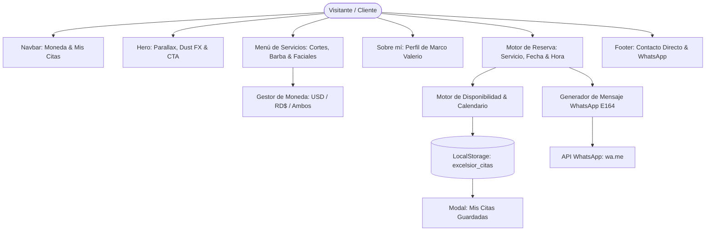

# Arquitectura Técnica — EXCELSIOR Barbería Clásica

> **Especificación técnica, flujo de datos y decisiones de diseño del sistema web de reservas de autor.**

---

## 1. Visión Arquitectónica

EXCELSIOR está estructurado como una **Single Page Application (SPA) ultraligera y autónoma**, construida con tecnologías web estándar (HTML5 semántico, Tailwind CSS y Vanilla JavaScript ES6+), sin frameworks pesados, empaquetadores ni dependencias de runtime.

---

## 2. Componentes del Sistema

### 2.1 Gestor de Moneda Dinámica (`setCurrency`)
- Admite tres modos de visualización reactiva:
  - `USD`: Precios formateados en dólares estadounidenses (`$22 USD`).
  - `DOP`: Precios formateados en pesos dominicanos con separadores locales (`RD$ 1,320`).
  - `BOTH`: Presentación bimonetaria simultánea para claridad total de clientes locales e internacionales.
- Se propaga en tiempo real a las tarjetas de servicios, al selector desplegable del formulario y al resumen del ticket.

### 2.2 Motor de Disponibilidad y Horarios (`SlotEngine`)
- **Regla de 1 a 1:** Al ser un servicio individual de un solo barbero, una franja horaria reservada queda automáticamente bloqueada para otros clientes en la misma fecha.
- **Detección de Horas Pasadas:** Si el usuario consulta la fecha actual, los horarios que ya pasaron (con un margen de preparación de 30 minutos) quedan deshabilitados visual y funcionalmente.
- **Descanso Semanal:** Los domingos se reconocen automáticamente como días de cierre, sugiriendo de inmediato el próximo día hábil con cupos libres.

### 2.3 Persistencia y Privacidad (`LocalStorage`)
- El sistema almacena las citas confirmadas bajo la clave `excelsior_citas`.
- Los datos se guardan exclusivamente en el dispositivo del cliente, sin cookies de rastreo ni recopilación invasiva de telemetría.
- El usuario puede consultar o cancelar sus citas en cualquier momento a través del modal de historial.

### 2.4 Puente de Confirmación WhatsApp (`waLink`)
- Traduce los datos estructurados de la cita (nombre, servicio, fecha en lenguaje natural, hora, desglose de precio y notas) en una URL optimizada con codificación de texto URI (`https://wa.me/18095550199?text=...`).
- Permite que el barbero reciba en su chat de WhatsApp la notificación exacta de cada cita para validarla sin intermediarios.

---

## 3. Decisiones de Rendimiento y UI

| Métrica / Dimensión | Estrategia Implementada | Beneficio |
|---|---|---|
| **Velocidad de Carga** | 0 librerías pesadas / Assets optimizados | First Contentful Paint < 0.6s |
| **Animaciones** | GPU-accelerated (`transform`, `opacity`) | 60 FPS estables sin jank |
| **Micro-partículas** | Canvas nativo con `IntersectionObserver` | Cero consumo de CPU fuera de pantalla |
| **Responsividad** | Mobile-First con Tailwind CSS | Adaptado desde pantallas de 320px a 4K |
| **Accesibilidad** | WCAG AA, roles ARIA, atajos por teclado (ESC) | Inclusión total en lectores de pantalla |
