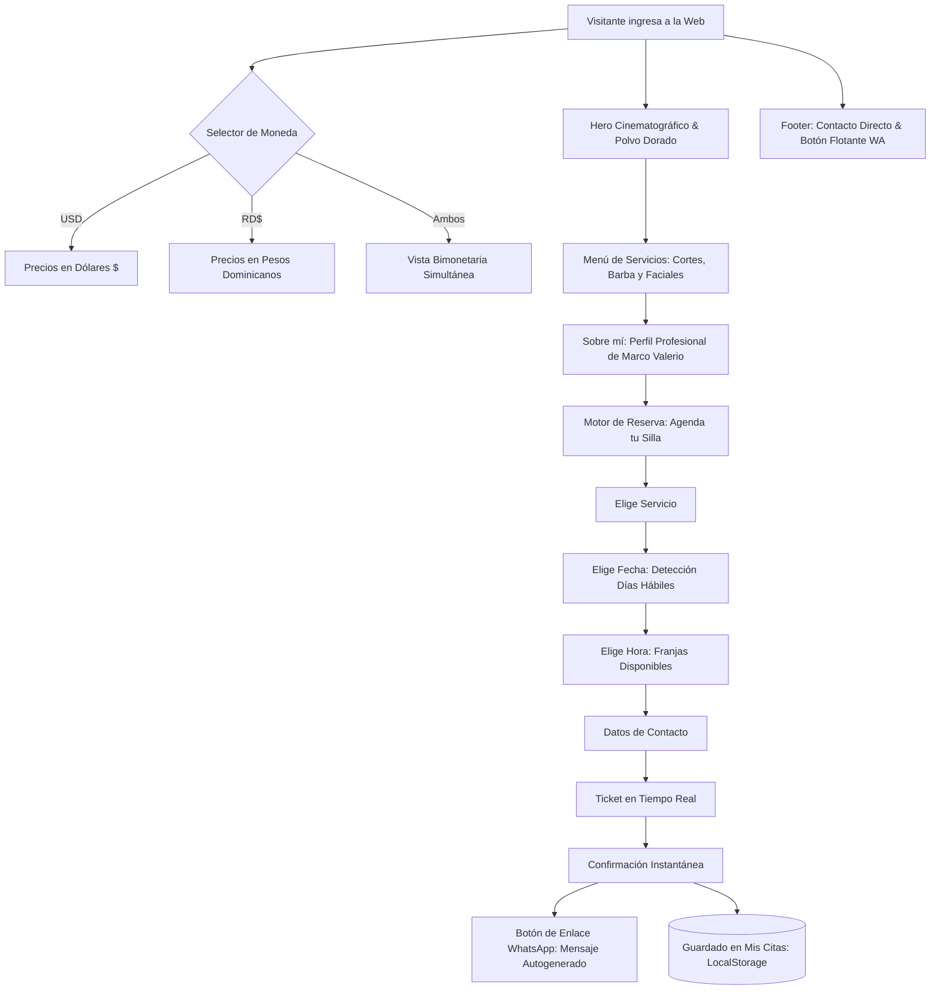

# EXCELSIOR — Salón & Barbería Clásica de Autor
> **El Templo del Buen Corte y la Navaja Clásica: Barbería Masculina de Autor & Sistema de Reservas Online**

[](https://github.com/HEROU7/excelsior-barberia)
[](https://herou7.github.io/excelsior-barberia/)
[](https://github.com/HEROU7/excelsior-barberia)
[](https://github.com/HEROU7/excelsior-barberia)
[](https://github.com/HEROU7/excelsior-barberia)
[](LICENSE)

> 🚀 **Experiencia en Vivo Disponible:** [https://herou7.github.io/excelsior-barberia/](https://herou7.github.io/excelsior-barberia/)

---

## 1. Visión & Manifiesto

En un sector saturado de franquicias y aplicaciones complejas, **EXCELSIOR** rinde homenaje al oficio clásico de la barbería tradicional: la navaja libre, la toalla caliente al vapor, el corte a tijera de precisión y la atención pausada uno a uno.

Esta plataforma web es la carta de presentación y centro de reservas de **Marco Valerio**, maestro barbero independiente con más de 12 años detrás de la silla. Cada detalle visual ha sido diseñado para transmitir exclusividad, confort y maestría artesanal:

1. **Atmósfera de Templo Clásico:** Estética inmersiva con fondos de madera noble de nogal, cuero oscuro envejecido, acentos de latón dorado y grano cinematográfico.
2. **Atención Personalizada 1 a 1:** Sin turnos compartidos, sin intermediarios y con comunicación directa al barbero.
3. **Economía Bimonetaria Transparente:** Consulta de precios en tiempo real tanto en **Dólares (USD $)** como en **Pesos Dominicanos (RD$)**, adaptado al cliente local y al visitante internacional.
4. **Reserva Eficiente sin Fricción:** Selección ágil de servicio, fecha y hora con confirmación directa vía **WhatsApp** y persistencia local sin requerir registro de cuenta.

---

## 2. Arquitectura de Navegación & Flujo



---

## 3. Especificación de Módulos

### MÓDULO 1: Hero Cinematográfico & Canvas de Partículas
- **Fondo de Barbería Clásica:** Imagen de alta resolución optimizada con sillón vintage de cuero oxblood, tocador de mármol y frascos de tónico bajo luz de tungsteno.
- **Canvas de Polvo Dorado (`hero-dust`):** Simulación por software en `<canvas>` nativo de micro-partículas doradas en suspensión, activo únicamente cuando la sección es visible (`IntersectionObserver`) para ahorrar recursos de batería en móviles.
- **Parallax Reactivo:** Movimiento de profundidad sutil vinculado al puntero del ratón en pantallas de escritorio.
- **Micro-indicadores Rápidos:** 12+ años de oficio, atención 1 a 1 y calificación de 4.9 ★ (+1,400 clientes satisfechos).

---

### MÓDULO 2: Menú de Peluquería & Barbería ("Cortes, Barba y Faciales")
- Subtítulo exacto: **`Cortes, Barba y Faciales`**.
- Filtros interactivos por categoría:
  - *Todos los Servicios*
  - *Cortes y Degradados*
  - *Barba y Navaja*
  - *Faciales*
  - *Paquetes Completos*
- Conversor de moneda reactivo en encabezado con actualización instantánea de precios.
- Nota informativa sobre la duración variable del servicio según el estilo y tipo de cabello.

---

### MÓDULO 3: Presentación Personal ("Sobre mí · Tu Barbero")
- Retrato fotográfico profesional de **Marco Valerio** con marco desplazado estilo galería de arte.
- Biografía breve, filosofía de oficio (*"Un buen corte no se apura"*) y especialidades en técnicas de tijera, *skin fade*, perfilado de barba a navaja libre y rituales faciales.
- Acceso directo para agendar o iniciar conversación por WhatsApp.

---

### MÓDULO 4: Motor de Reserva ("Agenda tu Silla")
- **Flujo Simplificado para 1 Barbero:** Se eliminó cualquier selector innecesario de barbero colectivo.
- **Calendario Inteligente:**
  - Fecha mínima automática en el día de hoy.
  - Bloqueo de domingos (días no laborales).
  - Detección automática del próximo día con cupos disponibles.
- **Selector de Horas Reactivo:**
  - Deshabilita horas ya reservadas por otros clientes en el mismo día.
  - Oculta horas que ya transcurrieron en el día actual (con margen de cortesía de 30 minutos).
- **Ticket en Tiempo Real:** Cálculo automático de duración estimada y desglose en USD y RD$.
- **Modal de Confirmación con WhatsApp:** Genera un mensaje listo para enviar al número del barbero:
  ```text
  Hola Marco, acabo de reservar una cita desde tu web:

  • Servicio: Skin Fade / Degradado a Navaja
  • Fecha: Miércoles, 15 de octubre
  • Hora: 11:00 AM
  • Total: $22 USD / RD$ 1,320
  • Nombre: David Vargas
  • Teléfono: 809-555-0199

  ¿Me la confirmas, por favor?
  ```
- **Historial de Mis Citas:** Permite al cliente consultar y cancelar sus reservas desde cualquier parte de la página mediante el botón del Navbar.

---

### MÓDULO 5: Footer & Contacto Directo
- Bloque destacado de resolución rápida de dudas con botones directos:
  - **WhatsApp:** Enlace directo con formato `wa.me/18095550199`.
  - **Teléfono:** Marcación directa con `tel:+18095550199`.
  - **Horario:** Ficha visible de atención (Lunes a sábado, 9:00 AM a 7:00 PM).
- **Botón Flotante (FAB):** Acceso permanente en la esquina inferior derecha con icono oficial y animación pulsante.
- **Línea de Derechos:**
  ```text
  EXCELSIOR BARBERÍA • Precios disponibles en USD ($) y Peso Dominicano (RD$) © 2026 Excelsior Salón & Barbería Clásica. Todos los derechos reservados.
  ```

---

## 4. Catálogo de Servicios y Precios

| Servicio | Categoría | Duración Aprox. | Precio USD | Precio RD$ |
|---|---|---|---|---|
| **Corte Clásico de Precisión** | Corte | 35 - 45 min | **$18 USD** | **RD$ 1,080** |
| **Skin Fade / Degradado a Navaja** | Corte | 40 - 45 min | **$22 USD** | **RD$ 1,320** |
| **Perfilado de Barba & Toalla Caliente** | Barba | 25 - 30 min | **$15 USD** | **RD$ 900** |
| **Afeitado Clásico Real al Ras** | Barba | 25 - 30 min | **$16 USD** | **RD$ 960** |
| **Facial Purificante Masculino** | Facial | 30 - 35 min | **$20 USD** | **RD$ 1,200** |
| **Servicio Completo: Corte + Barba** | Completo | 50 - 60 min | **$30 USD** | **RD$ 1,800** |
| **Gran Ritual Excelsior (Corte + Barba + Facial)** | VIP / Completo | 60 - 70 min | **$38 USD** | **RD$ 2,280** |

---

## 5. Stack Tecnológico

- **Estructura:** HTML5 semántico con etiquetado ARIA completo para lectores de pantalla.
- **Estilos:** Tailwind CSS CDN (diseño responsivo con tema extendido personalizado).
- **Tipografía:** *Playfair Display* (titulares y rótulo de barbería clásica) e *Instrument Sans* (cuerpo y legibilidad moderna) vía Google Fonts.
- **Iconografía:** Lucide Icons & SVG oficial de WhatsApp.
- **Lógica e Interactividad:** Vanilla JavaScript modular moderno (ES6+), sin dependencias ni compilación requerida.
- **Almacenamiento Local:** Web Storage API (`localStorage`).

---

## 6. Ejecución Local

Para probar o modificar el proyecto en tu máquina local:

```bash
# 1. Clona el repositorio
git clone https://github.com/HEROU7/excelsior-barberia.git

# 2. Entra al directorio
cd excelsior-barberia

# 3. Inicia un servidor estático (elige una de estas opciones):
python -m http.server 8000
# o
npx serve .

# 4. Abre tu navegador en:
# http://localhost:8000
```

---

## 7. Despliegue en Tiempo Real (GitHub Pages)

El proyecto está configurado para publicarse de forma continua e ilimitada a través de **GitHub Pages**. Cada actualización realizada en la rama `main` se publica automáticamente.

- **URL Pública Oficial:** [https://herou7.github.io/excelsior-barberia/](https://herou7.github.io/excelsior-barberia/)
- **Compatibilidad:** 100% responsive en iPhone, iPad, Android, laptops y monitores ultraanchos.

---

## 8. Licencia & Créditos

Desarrollado y mantenido por **[HEROU7](https://github.com/HEROU7)** bajo Licencia [MIT](LICENSE).  
© 2026 Excelsior Salón & Barbería Clásica. Todos los derechos reservados.
